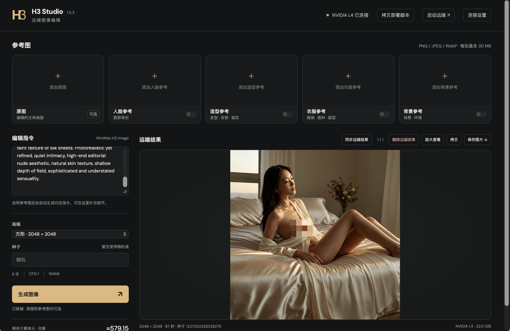

# H3 Studio

[English](README.en.md) · [在 Colab 打开部署笔记本](https://colab.research.google.com/github/bennix/H3Studio/blob/main/H3-Studio-Colab.ipynb)

macOS 图像生成与参考编辑客户端，通过密码保护的公网入口调用 Colab 上的 ComfyUI 和 MiniMax H3 Image。模型下载、推理和生成结果均位于 Colab 远端。



## 准备环境

- Mac 运行 macOS 13 或更新版本，并安装 Xcode Command Line Tools。
- Google Colab 账号，能够分配 GPU。建议 L4、约 24 GB 显存和高 RAM。
- Colab 磁盘需容纳约 29.4 GB 模型，以及 Python 依赖、缓存和生成结果。
- 一个 Gmail 账号，用于向自己发送公网地址和本次登录密码。

已在 NVIDIA L4 上验证 2048 × 2048、6 步、CFG 1。实际 GPU 可用性、运行时长和费率由 Colab 决定。

## 1. 构建并启动应用

首次使用时安装 Apple 开发工具，在弹出的系统窗口中完成安装。

```sh
xcode-select --install
```

克隆仓库并构建。构建产物使用当前 Mac 的 CPU 架构，并进行本机临时签名。

```sh
git clone https://github.com/bennix/H3Studio.git
cd H3Studio
./H3Studio/build.sh "$HOME/Applications/H3 Studio.app"
open "$HOME/Applications/H3 Studio.app"
```

之后可以直接从 `~/Applications/H3 Studio.app` 启动。

## 2. 从空白 Colab 一键部署

1. 在应用中点击“启动远端”。应用会把完整部署脚本拷贝到系统剪贴板，并打开新的 Colab 笔记本。
2. 在 Colab 选择“代码执行程序 → 更改运行时类型”，选中 **L4 GPU**，开启高 RAM，保存并连接。
3. 新建一个代码单元格，粘贴剪贴板中的完整脚本，点击运行。
4. 根据提示填写 Gmail 邮箱，并提供该账号的应用专用密码。首次运行会安装 ComfyUI、下载三项模型、安装参考编辑与结果管理节点、启动密码保护代理和 Cloudflare 临时入口。
5. 等到输出显示远端已就绪，并在 Gmail 中收到“ComfyUI 启动登录信息”。邮件包含公网地址、用户名和登录密码。

也可直接打开仓库提供的部署笔记本，选择 GPU 后运行代码单元格。两种方式使用同一份部署代码。

[打开 Colab 部署笔记本](https://colab.research.google.com/github/bennix/H3Studio/blob/main/H3-Studio-Colab.ipynb)

“拷贝部署脚本”按钮只负责复制脚本，方便粘贴到已有的个人笔记本。源文件位于 [colab_deploy.py](H3Studio/Resources/colab_deploy.py)。应用无法代替用户在 Colab 网页中选择 GPU 和点击运行。

### 生成 Gmail 应用专用密码

1. 使用上一步填写的 Gmail 账号登录 Google，开启两步验证。[Google 两步验证](https://myaccount.google.com/signinoptions/two-step-verification)
2. 打开“应用专用密码”页面，按 Google 提示重新验证身份。[Google 应用专用密码](https://myaccount.google.com/apppasswords)
3. “应用名称”填写 **H3 Studio**，点击“创建”。
4. 复制 Google 生成的 **16 位应用专用密码**，粘贴到 Colab 脚本显示的隐藏输入框，回车提交。脚本会自动去除空格。

临时输入仅保留在当前 Colab 运行时的内存中。以后需要自动读取时，可以在 Colab 左侧“Secret / 密钥”添加名为 `COMFY_GMAIL_APP_PASSWORD` 的密钥，将应用专用密码填入其值，并开启当前笔记本的访问权限。脚本会优先读取已授权的 Secret，读取失败时显示生成指引和隐藏输入框。

若账号没有“应用专用密码”选项，请先检查两步验证是否开启。受组织管理的账号还需符合组织的账号设置。

## 3. 连接与生成

1. 回到 H3 Studio 的“连接设置”，填写本次邮件中的公网地址、用户名 `comfy` 和登录密码。
2. 点击“连接远端”，连接后会同步远端输出目录中最近 100 张结果。
3. 原图和四类参考图均为可选。直接填写提示词可生图，也可添加原图进行编辑，或使用人脸、造型、衣服、背景参考图。参考图可单独或组合启用。
4. 添加图片后显示缩略图，右上角 `×` 可移除附件。设置画幅、可选种子，点击“生成图像”。
5. 完成后在“远端结果”查看图片，支持放大、滚轮缩放、拖动平移、保存和拷贝。
6. “删除远端结果”会把文件移动到远端回收目录，“撤销删除”可恢复。回收目录与结果均随 Colab 临时磁盘生命周期保存。

人脸采用生成式身份参考。已验证无原图参考生成和原图换背景，人脸相似度、换装及姿态效果仍需用实际参考图核对。

### 计算单元

连接后自动读取远端已保存的余额基准。首次使用可在应用中展开“校准余额 / 费率”，填写 Colab 资源面板显示的当前余额和每小时消耗，点击“保存到远端”。之后按经过时间估算剩余值。官方实时余额仍以 Colab 面板为准，其他会话和费率变化需要重新校准。

## 再次启动和结束使用

- 同一 Colab 运行时仍在运行时，直接打开应用，使用对应邮件中的地址和密码连接。
- 需要重新部署时，在自己的笔记本中再次运行部署单元格。模型文件仍存在时会复用并校验，缺失时重新下载。
- 新建或删除运行时会影响临时文件。需要保留的结果请先保存到 Mac。
- Cloudflare 临时地址可能变化，使用最近一次成功启动邮件中的信息。公网入口受密码保护，知道地址和密码的人可以使用该 GPU 服务。
- 关闭 Mac 应用后，Colab 运行时仍可能继续消耗计算单元。结束使用后，在 Colab 选择断开连接并删除运行时。Colab 会话有运行时限，应用不保证持续保活。

## 常见问题

| 情况 | 处理方法 |
| --- | --- |
| 找不到 `nvidia-smi` | 当前可能是 CPU 或 TPU。切换到 NVIDIA GPU，再重新运行。 |
| Gmail 密钥读取失败 | 检查 Secret 名称和当前笔记本授权，也可按提示临时输入应用专用密码。 |
| 没收到邮件 | 查看垃圾邮件，核对发送 Gmail 与应用专用密码是否对应。已有服务时，可运行仓库中的补发邮件脚本。 |
| 长期显示“正在恢复执行” | 检查 Colab 网络连接，在“其他连接选项”中重新连接现有 L4 运行时，再查看输出中是否等待输入。 |
| 出现 401 | 使用最近一次邮件中的用户名和密码。 |
| 链接失效或 502 | 检查 Colab、ComfyUI 和隧道是否运行，必要时重跑部署单元格获取新邮件。 |
| 显存不足 | 减小分辨率或参考图数量，或选择更大显存的 GPU。 |

邮件补发脚本只使用当前运行时已存在的 URL 和密码。在同一 Colab 运行时中新建代码单元格，粘贴并运行 [resend_h3_login_email_colab.py](resend_h3_login_email_colab.py)。

## 开发验证

在仓库根目录运行。Python 单元测试使用标准库，前端手势测试需要 Node.js，Swift 测试需要 Apple 开发工具。

```sh
python3 -m unittest discover -s tests -v
node --check H3Studio/Resources/app.js
node tests/test_client_viewer.cjs
swiftc H3Studio/Sources/RemoteImage.swift tests/remote_image_metadata.swift -o /tmp/h3-metadata-test
/tmp/h3-metadata-test
```

应用源码位于 `H3Studio/Sources`，界面与打包部署脚本位于 `H3Studio/Resources`。独立 ComfyUI 扩展源码位于 `comfyui_h3_reference_edit`、`comfyui_full_canvas_export` 和 `comfyui_colab_model_download`。部署笔记本的代码单元格应与打包脚本保持一致。

## 模型与依赖

当前部署下载以下权重，总计约 29.4 GB。模型和依赖的使用条件以各自仓库说明为准。

| 组件 | 文件 |
| --- | --- |
| Diffusion model | `minimax_h3_image_pruned_w4a8.safetensors` |
| Text encoder | `qwen3vl_32b_minimax_h3_nvfp4_awq.safetensors` |
| VAE | `minimax_h3_image_vae_fp16.safetensors` |

[ComfyUI](https://github.com/Comfy-Org/ComfyUI) · [MiniMax H3 Image 权重](https://huggingface.co/Comfy-Org/MiniMax-H3-Image) · [Cloudflared](https://github.com/cloudflare/cloudflared) · [DM Sans 字体许可证](H3Studio/Resources/OFL.txt)
